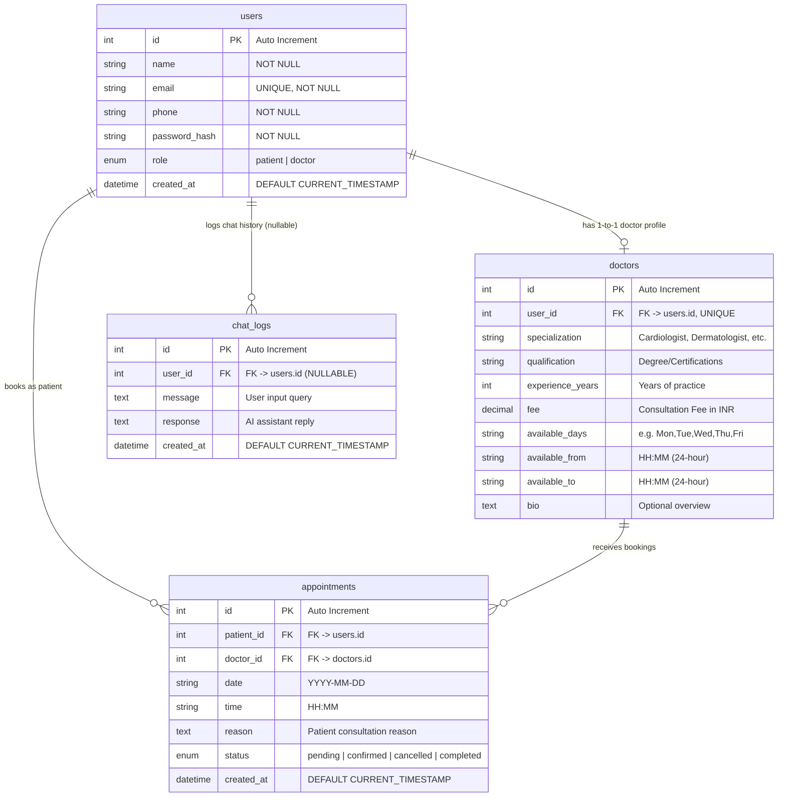

# MedBook Entity Relationship (ER) Diagram

Below is the Mermaid ER Diagram representing the 4 core database tables in MedBook (`users`, `doctors`, `appointments`, `chat_logs`) and their foreign key relationships.

## Entity Constraints & Business Rules
1. **1-to-1 User to Doctor**: Each record in `doctors` is tied uniquely to a `users` record where `role = 'doctor'`.
2. **Double Booking Prevention**: The `appointments` table enforces a unique index on `(doctor_id, date, time)` for non-cancelled appointments.
3. **Nullable Chat Logs**: Guests can use the AI Assistant before logging in; in this case `chat_logs.user_id` is set to `NULL`.
